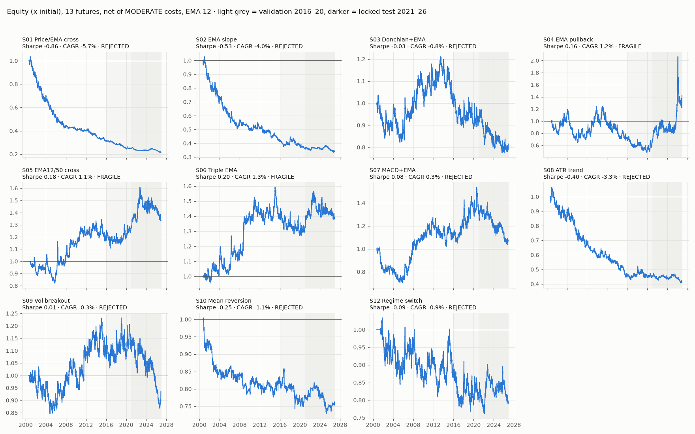

# Do 12-period EMA strategies work on futures?

> A reproducible test of 12 EMA-based strategies on 13 liquid futures (2001–2026), with pre-registered pass criteria, walk-forward validation and cost stress tests. Brief: `docs/BRIEF.md` · plan and criteria: `docs/PLAN.md`.

## Result in one paragraph
**No strategy passed the six criteria fixed before the test.** The 12-period EMA is too fast for daily futures: as a stand-alone signal it loses after realistic costs (Sharpe −0.4 to −0.9), and every strategy improves with slower EMAs (50–100). The best candidates, S06 Triple EMA and S05 EMA12/50 cross, are positive across most markets and survive severe costs, but miss the out-of-sample bar. S04's strong 2021–26 result comes from two metal trades. Full report: **[REPORT.md](REPORT.md)**.



## How it was done
- 13 futures (equity, energy, metals, FX, rates), daily bars Sep 2000 – Nov 2026, roll-adjusted (`docs/DATA.md`); NQ 5-min for the intraday strategy.
- 12 strategies (`docs/STRATEGIES.md`), one engine: next-open fills, commissions + slippage, 0.5% risk sizing, portfolio and asset-class risk caps, margin cap, daily loss limit.
- Pass criteria and splits written before any run (`docs/PLAN.md`); locked 2021–26 test; walk-forward; EMA 8–100 sensitivity; 1×/2×/3× cost stress; regime breakdowns.
- Tests include a no-look-ahead check (changing the future must not change past signals).

## Reproduce
```bash
pip install -r requirements.txt
python scripts/run_all.py && python scripts/make_report.py && python scripts/build_report.py
pytest
```

## Layout
`src/casestudy/` code · `scripts/` pipeline · `results/` tables and figures · `docs/` brief, plan, data notes, strategy spec · `tests/`.

*Hypothetical backtested results; not investment advice.*
