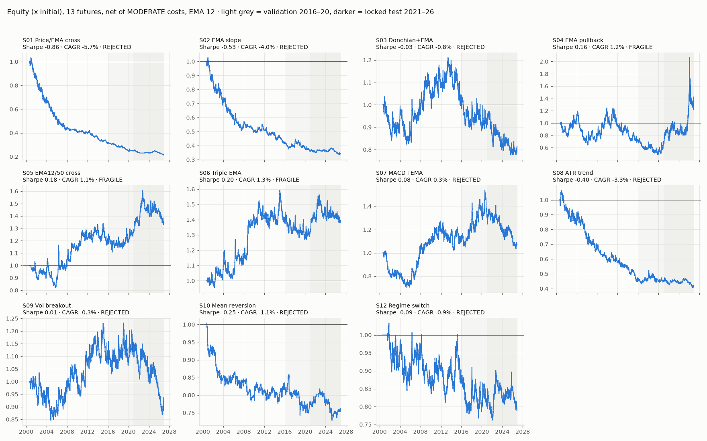
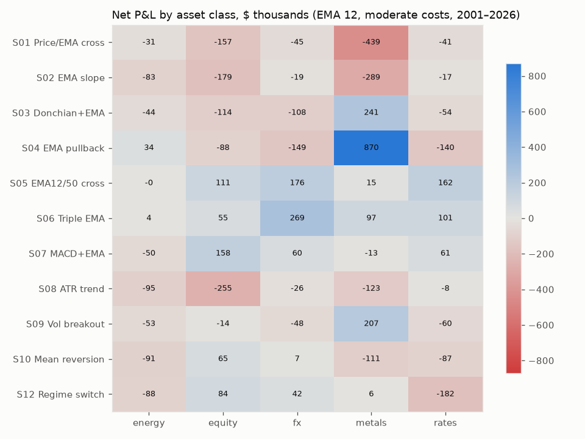
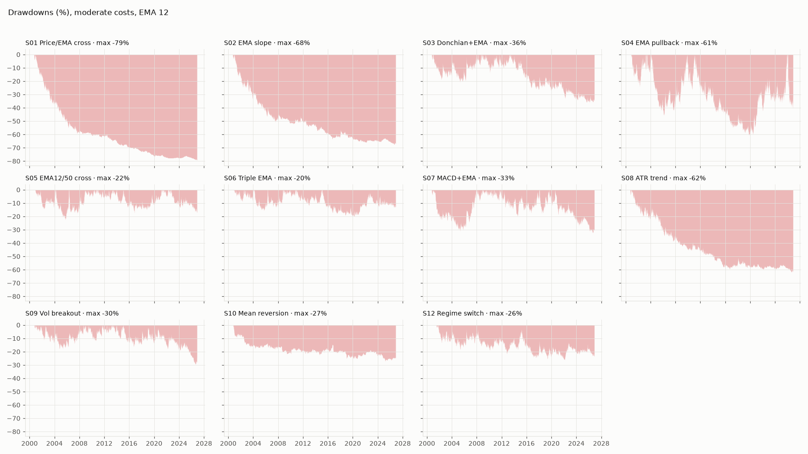
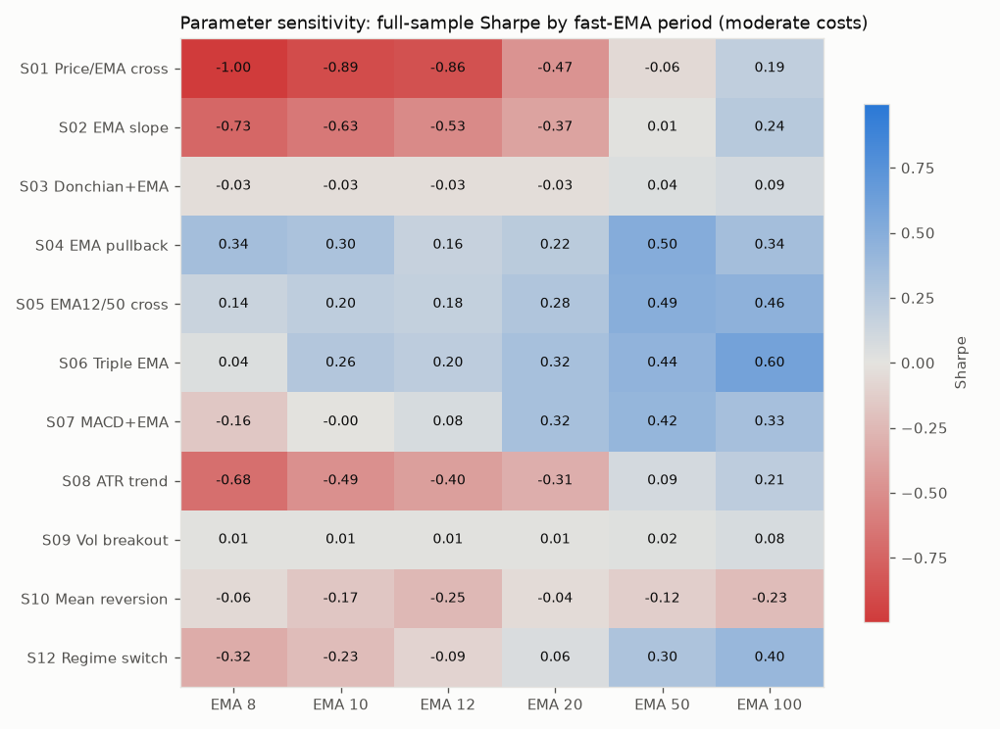
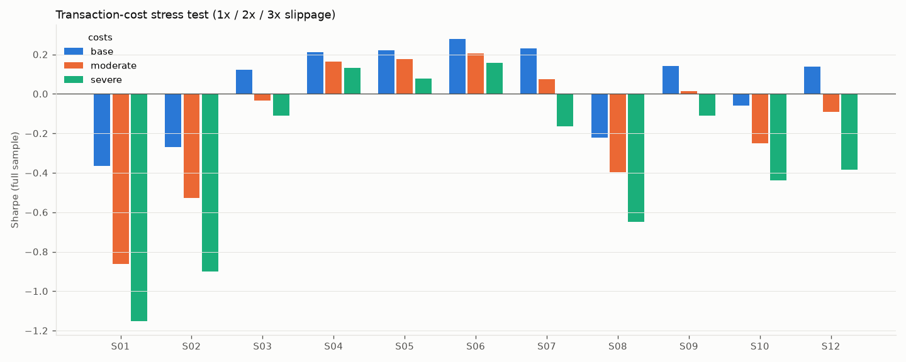
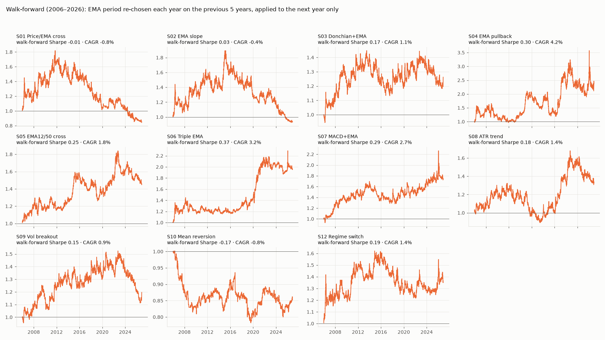

# Do 12-period EMA strategies work on futures? A 26-year, 13-market test

*Backtest research. Historical, hypothetical results; not a forecast and not investment advice (see the disclaimer at the end).*

## 1. Executive summary

- **No strategy passed all six pre-registered criteria** (`docs/PLAN.md`, written before any run). 3 of 11 daily strategies are **fragile**, 8 are **rejected**.
- **The 12-period EMA is too fast for daily futures.** As a stand-alone signal (S01 price/EMA cross, S02 slope, S08 ATR trend) it loses money after realistic costs in every split: full-sample Sharpe −0.40 to −0.86 at moderate costs, and still negative at base costs. Turnover (300–500 trades a year across 13 markets) eats the small edge.
- **Every strategy improves as the EMA gets slower** (parameter heatmap). Walk-forward re-optimisation chose EMA 50–100 in most years for 9 of 11 strategies. The edge, where there is one, is slow trend-following, not the 12-period EMA.
- **Best candidates, still not robust:** S06 Triple EMA (positive in 10/13 markets and 5/5 asset classes, max drawdown −20%, Sharpe 0.16 even at severe costs) and S05 EMA12/50 cross. Both fail the out-of-sample Sharpe > 0.3 bar (0.17 and 0.14 in 2021–26).
- **S04 EMA pullback has the best test-period Sharpe (0.57) but is rejected as a recommendation:** its whole profit comes from 2 trades (silver and gold, 2025–26). Without its top 1% of trades it loses $2.1M, and its max drawdown is −61%.
- **S11 intraday opening-range breakout (NQ 5-min):** +0.15R per trade in its first 2 years (75 trades), then +0.015R in the test period (328 trades). It decays to roughly zero; not robust.
- **Recommendation:** deploy none. Take S06 and S05 forward only as slow-EMA versions, re-specified and pre-registered now, then paper-traded on new data (section 12).

## 2. Data and methodology

| | |
|---|---|
| Markets | ES, NQ, YM (equity) · CL, NG (energy) · GC, SI, HG (metals) · 6E, 6J, 6B (FX) · ZB, ZN (rates) |
| Daily data | Yahoo Finance front-month continuous `=F` series, Sep 2000 – 23 Nov 2026 (6,200–6,600 bars each) |
| Roll handling | Additive back-adjustment. Equity, FX and Treasuries roll on exact expiry calendars (≈4 rolls/yr); CL, NG and metals use the largest gap in a monthly window (approximate). Details: `docs/DATA.md` |
| Cleaning | Isolated spike-and-revert bars removed (4 bars in 26 years, e.g. 6J 2001-12-17 printed 10× too low). Real crashes kept (silver −31% on 2026-01-30). |
| Intraday (S11) | Dukascopy 1-min Nasdaq-100 CFD (proxy for NQ), resampled to 5-min, 566 sessions (Nov 2022 – Nov 2026, with gaps) |
| Splits | In-sample 2001–2015 · validation 2016–2020 · **locked test 2021–2026** · walk-forward 5-year train → 1-year test, 2006–2026 |

Every indicator at bar *t* uses only bars ≤ *t*; a unit test changes the future and checks that no past signal moves (`tests/test_engine.py`).

## 3. Strategy definitions
Full specification: `docs/STRATEGIES.md`. Summary: S01 price/EMA cross · S02 EMA + 5-bar slope · S03 20-bar Donchian + EMA filter, 10-bar trailing stop · S04 pullback to EMA12 in an EMA12>EMA50 trend, swing stop · S05 EMA12/50 cross · S06 EMA 12/26/50 alignment · S07 MACD 12/26/9 + EMA filter · S08 EMA + rising ATR, 3-ATR chandelier · S09 20-bar breakout + rising EMA, 2-ATR trail · S10 ±2σ mean reversion around EMA12 with an EMA50/200 trend veto · S11 30-min opening-range breakout + 5-min EMA12 · S12 EMA12 trigger inside an EMA12-vs-EMA200 regime.

## 4. Backtesting assumptions
Signals at the bar close; fills at the next bar's open. A stop already beyond the open fills at the open; otherwise at the stop level. No same-bar profit targets. Positions held through a roll day pay one extra round turn.

## 5. Transaction-cost model
Per contract per side: **$2.50** commission and fees, plus slippage of 1 tick (ES, NQ, YM, GC, FX, Treasuries) or 2 ticks (CL, NG, SI, HG). Base = 1×, **moderate = 2× (used for every verdict)**, severe = 3× slippage.

## 6. Position-sizing framework
`contracts = floor(0.5% × equity / (stop distance × point value))` on a $1M account. Minimum stop = 0.5 ATR. Caps: 10% total open risk, 4% per asset class, margin ≤ 50% of equity, daily loss limit 2% (no new entries the next day). No leverage beyond what margin implies.

## 7. Performance results (EMA 12, moderate costs)



| Strategy | Verdict | Criteria met | Full Sharpe | Full CAGR | Max DD | Test Sharpe | Test CAGR | Test trades | Walk-fwd Sharpe | Severe-cost Sharpe | Markets + | Classes + | Net P&L $k | Without top 1% trades $k |
|---|---|---|---|---|---|---|---|---|---|---|---|---|---|---|
| S04 EMA pullback | **FRAGILE** | 5/6 | 0.16 | 1.2% | -61.4% | 0.57 | 12.8% | 553 | 0.30 | 0.13 | 7/13 | 2/5 | 528 | -2,096 (−25) |
| S06 Triple EMA | **FRAGILE** | 4/6 | 0.20 | 1.3% | -20.2% | 0.17 | 0.9% | 302 | 0.37 | 0.16 | 10/13 | 5/5 | 527 | -436 (−18) |
| S05 EMA12/50 cross | **FRAGILE** | 4/6 | 0.18 | 1.1% | -22.4% | 0.14 | 0.8% | 281 | 0.25 | 0.08 | 10/13 | 4/5 | 464 | -505 (−17) |
| S09 Vol breakout | **REJECTED** | 2/6 | 0.01 | -0.3% | -29.5% | -0.37 | -3.1% | 591 | 0.15 | -0.11 | 6/13 | 1/5 | 33 | -876 (−31) |
| S12 Regime switch | **REJECTED** | 1/6 | -0.09 | -0.9% | -26.3% | -0.06 | -0.5% | 805 | 0.19 | -0.38 | 7/13 | 3/5 | -139 | -1,292 (−53) |
| S03 Donchian+EMA | **REJECTED** | 1/6 | -0.03 | -0.8% | -35.9% | -0.20 | -2.0% | 489 | 0.17 | -0.11 | 5/13 | 1/5 | -79 | -997 (−28) |
| S08 ATR trend | **REJECTED** | 1/6 | -0.40 | -3.3% | -61.9% | -0.26 | -1.5% | 698 | 0.18 | -0.65 | 3/13 | 0/5 | -508 | -1,342 (−56) |
| S07 MACD+EMA | **REJECTED** | 1/6 | 0.08 | 0.3% | -32.6% | -0.37 | -3.6% | 970 | 0.29 | -0.16 | 7/13 | 3/5 | 217 | -1,215 (−50) |
| S10 Mean reversion | **REJECTED** | 0/6 | -0.25 | -1.1% | -27.5% | -0.17 | -0.6% | 284 | -0.17 | -0.44 | 6/13 | 2/5 | -217 | -383 (−17) |
| S02 EMA slope | **REJECTED** | 0/6 | -0.53 | -4.0% | -67.6% | -0.20 | -0.9% | 590 | 0.03 | -0.90 | 2/13 | 0/5 | -587 | -1,277 (−52) |
| S01 Price/EMA cross | **REJECTED** | 0/6 | -0.86 | -5.7% | -79.3% | -0.76 | -2.6% | 464 | -0.01 | -1.15 | 1/13 | 0/5 | -713 | -1,332 (−54) |

Failed criteria per strategy:

- **S04 EMA pullback**: 4 >= 60% markets and >= 3/5 classes positive
- **S06 Triple EMA**: 1 test Sharpe > 0.3; 3 test PF > 1.1 and >= 100 trades
- **S05 EMA12/50 cross**: 1 test Sharpe > 0.3; 3 test PF > 1.1 and >= 100 trades
- **S09 Vol breakout**: 1 test Sharpe > 0.3; 3 test PF > 1.1 and >= 100 trades; 4 >= 60% markets and >= 3/5 classes positive; 6 positive under severe costs
- **S12 Regime switch**: 1 test Sharpe > 0.3; 3 test PF > 1.1 and >= 100 trades; 4 >= 60% markets and >= 3/5 classes positive; 5 EMA 10 & 20 keep >= 50% of EMA-12 Sharpe; 6 positive under severe costs
- **S03 Donchian+EMA**: 1 test Sharpe > 0.3; 3 test PF > 1.1 and >= 100 trades; 4 >= 60% markets and >= 3/5 classes positive; 5 EMA 10 & 20 keep >= 50% of EMA-12 Sharpe; 6 positive under severe costs
- **S08 ATR trend**: 1 test Sharpe > 0.3; 3 test PF > 1.1 and >= 100 trades; 4 >= 60% markets and >= 3/5 classes positive; 5 EMA 10 & 20 keep >= 50% of EMA-12 Sharpe; 6 positive under severe costs
- **S07 MACD+EMA**: 1 test Sharpe > 0.3; 3 test PF > 1.1 and >= 100 trades; 4 >= 60% markets and >= 3/5 classes positive; 5 EMA 10 & 20 keep >= 50% of EMA-12 Sharpe; 6 positive under severe costs
- **S10 Mean reversion**: 1 test Sharpe > 0.3; 2 walk-forward positive; 3 test PF > 1.1 and >= 100 trades; 4 >= 60% markets and >= 3/5 classes positive; 5 EMA 10 & 20 keep >= 50% of EMA-12 Sharpe; 6 positive under severe costs
- **S02 EMA slope**: 1 test Sharpe > 0.3; 2 walk-forward positive; 3 test PF > 1.1 and >= 100 trades; 4 >= 60% markets and >= 3/5 classes positive; 5 EMA 10 & 20 keep >= 50% of EMA-12 Sharpe; 6 positive under severe costs
- **S01 Price/EMA cross**: 1 test Sharpe > 0.3; 2 walk-forward positive; 3 test PF > 1.1 and >= 100 trades; 4 >= 60% markets and >= 3/5 classes positive; 5 EMA 10 & 20 keep >= 50% of EMA-12 Sharpe; 6 positive under severe costs

Full metrics (total return, CAGR, max drawdown and its duration, Sharpe, Sortino, Calmar, profit factor, win rate, average win/loss, expectancy, trades per year, holding period, exposure, exposure-adjusted return):

| Strategy | Total return | CAGR | Max DD | DD days | Sharpe | Sortino | Calmar | PF | Win rate | Avg win $ | Avg loss $ | Expectancy $ | Exp. R | Trades/yr | Hold days | Exposure | Exp.-adj. return |
|---|---|---|---|---|---|---|---|---|---|---|---|---|---|---|---|---|---|
| S01 Price/EMA cross | -78.5% | -5.7% | -79.3% | 9482 | -0.86 | -1.13 | -0.07 | 0.79 | 27.1% | 1,802 | -852 | -131 | -0.073 | 207 | 5.6 | 92.8% | -6.1% |
| S02 EMA slope | -65.9% | -4.0% | -67.6% | 9455 | -0.53 | -0.74 | -0.06 | 0.84 | 29.5% | 2,040 | -1,015 | -114 | -0.050 | 196 | 6.7 | 97.6% | -4.1% |
| S03 Donchian+EMA | -18.5% | -0.8% | -35.9% | 4926 | -0.03 | -0.05 | -0.02 | 0.99 | 33.6% | 5,707 | -2,934 | -28 | 0.004 | 108 | 14.6 | 99.4% | -0.8% |
| S04 EMA pullback | 37.1% | 1.2% | -61.4% | 5840 | 0.16 | 0.21 | 0.02 | 1.08 | 18.4% | 16,315 | -3,411 | 210 | 0.167 | 96 | 23.4 | 99.2% | 1.2% |
| S05 EMA12/50 cross | 33.5% | 1.1% | -22.4% | 2233 | 0.18 | 0.24 | 0.05 | 1.13 | 26.5% | 9,332 | -2,982 | 281 | 0.061 | 63 | 38.0 | 99.2% | 1.1% |
| S06 Triple EMA | 39.3% | 1.3% | -20.2% | 4312 | 0.20 | 0.29 | 0.06 | 1.13 | 31.2% | 8,216 | -3,305 | 292 | 0.075 | 69 | 30.8 | 99.2% | 1.3% |
| S07 MACD+EMA | 7.0% | 0.3% | -32.6% | 2432 | 0.08 | 0.11 | 0.01 | 1.02 | 35.1% | 5,572 | -2,941 | 43 | 0.009 | 190 | 11.2 | 99.6% | 0.3% |
| S08 ATR trend | -58.6% | -3.3% | -61.9% | 9455 | -0.40 | -0.55 | -0.05 | 0.89 | 29.3% | 2,429 | -1,133 | -90 | -0.037 | 215 | 6.6 | 97.9% | -3.4% |
| S09 Vol breakout | -6.4% | -0.3% | -29.5% | 2880 | 0.01 | 0.02 | -0.01 | 1.01 | 35.9% | 5,408 | -3,017 | 11 | 0.012 | 118 | 12.3 | 99.3% | -0.3% |
| S10 Mean reversion | -24.7% | -1.1% | -27.5% | 9533 | -0.25 | -0.30 | -0.04 | 0.91 | 56.5% | 2,180 | -3,118 | -127 | -0.027 | 65 | 6.3 | 76.8% | -1.4% |
| S12 Regime switch | -21.0% | -0.9% | -26.3% | 9146 | -0.09 | -0.12 | -0.03 | 0.97 | 28.9% | 3,464 | -1,448 | -26 | -0.004 | 202 | 6.1 | 95.5% | -0.9% |

Sharpe by period:

| Strategy | In-sample 2001–15 | Validation 2016–20 | Test 2021–26 |
|---|---|---|---|
| S01 Price/EMA cross | -0.99 | -0.82 | -0.76 |
| S02 EMA slope | -0.70 | -0.36 | -0.20 |
| S03 Donchian+EMA | 0.02 | -0.08 | -0.20 |
| S04 EMA pullback | -0.04 | 0.07 | 0.57 |
| S05 EMA12/50 cross | 0.20 | 0.21 | 0.14 |
| S06 Triple EMA | 0.29 | -0.10 | 0.17 |
| S07 MACD+EMA | 0.12 | 0.38 | -0.37 |
| S08 ATR trend | -0.64 | 0.04 | -0.26 |
| S09 Vol breakout | 0.09 | 0.17 | -0.37 |
| S10 Mean reversion | -0.16 | -0.27 | -0.17 |
| S12 Regime switch | -0.09 | -0.13 | -0.06 |

S11 intraday (NQ 5-min, CFD proxy):

| S11 (NQ 5-min) | Split | Trades | Win | Avg R | t | P&L $ | PF |
|---|---|---|---|---|---|---|---|
| base | in_sample | 75 | 52.0% | 0.156 | 1.53 | 50,738 | 1.63 |
| base | test | 328 | 41.5% | 0.019 | 0.44 | 20,235 | 1.07 |
| base | all | 403 | 43.4% | 0.045 | 1.11 | 70,973 | 1.19 |
| moderate | in_sample | 75 | 52.0% | 0.149 | 1.46 | 48,398 | 1.59 |
| moderate | test | 328 | 41.5% | 0.015 | 0.35 | 15,415 | 1.05 |
| moderate | all | 403 | 43.4% | 0.040 | 1.00 | 63,813 | 1.17 |
| severe | in_sample | 75 | 52.0% | 0.142 | 1.39 | 46,058 | 1.55 |
| severe | test | 328 | 41.2% | 0.011 | 0.26 | 10,595 | 1.04 |
| severe | all | 403 | 43.2% | 0.036 | 0.88 | 56,653 | 1.15 |

| S11 EMA period | Trades | Avg R | t |
|---|---|---|---|
| 8 | 403 | 0.044 | 1.09 |
| 10 | 403 | 0.044 | 1.10 |
| 12 | 403 | 0.040 | 1.00 |
| 20 | 398 | 0.039 | 0.99 |
| 50 | 390 | 0.028 | 0.70 |
| 100 | 376 | 0.021 | 0.52 |

By market, asset class, calendar year and month: `results/by_sym.csv`, `results/by_cls.csv`, `results/by_year.csv`, `results/monthly/`.



## 8. Risk analysis


- The fast systems (S01, S02, S08) had drawdowns of −60% to −80% that never recovered. That's a slow bleed from costs, not one crash.
- S05 and S06 kept drawdowns near −20%.
- **Trend-following P&L is concentrated.** For every strategy, removing the best 1% of trades turns the total negative. That's normal for trend systems (they live on rare long trends). But it means a few missed trades can erase years, and S04 is the extreme case.
- **Strategy returns are correlated:** average pairwise correlation 0.36, max 0.89. Combining the trend variants diversifies little.

## 9. Robustness testing
**Parameter sensitivity.** All strategies except S10 get better as the EMA slows from 8 to 50–100. The 12 is never the best choice, and for S01, S02 and S08 the 8–20 neighbourhood is uniformly negative.



**Cost stress.** Only S04, S05 and S06 stay positive at 3× slippage. S01 goes from −0.37 to −1.15 Sharpe as costs rise.



**Regimes** (average R per trade by the regime at entry; `results/by_trend.csv`, `by_vol.csv`, `by_market.csv`):
- S04 makes its money in trending (+0.54R) and low-volatility (+0.34R) conditions.
- S06 does best in sideways markets (+0.15R) and loses in strongly trending ones as defined here (−0.15R), so its exits are late.
- S12's regime filter fails in sideways markets (−0.28R), exactly where it was meant to protect.

## 10. Walk-forward validation
Each year from 2006, the EMA period with the best Sharpe over the previous 5 years is applied to the next year only.



Walk-forward Sharpe is modestly positive for 9 of 11 strategies (0.03–0.37). That is because it keeps choosing **slow** EMAs (100 in most years for S01, S02, S03, S08 and S09), not the 12. Caveat: walk-forward years are stitched from full-period runs per parameter, so the equity path inside a year is approximate.

## 11. Strategy rankings
1. **S06 Triple EMA:** fragile. The broadest edge (10/13 markets, 5/5 classes), the lowest drawdown, cost-resilient. Fails test Sharpe (0.17 < 0.3) and test profit factor.
2. **S05 EMA12/50 cross:** fragile. Similar profile with a slightly weaker test.
3. **S04 EMA pullback:** fragile by the rules (5/6), but not recommended: one silver trade and one gold trade make all of its profit, and its −61% drawdown is unacceptable.
4. **Rejected:** S07, S09, S03, S12, S08, S10, S02, S01 (worst).
5. **S11 intraday:** not robust; its edge decays to ~0 out of sample.

## 12. Implementation recommendations
- **Do not trade any of these as specified.** None meets the bar set before the test.
- **Next study (pre-register before running):** S06 and S05 with fast EMA 50, a slow EMA ×2–4, and an ATR-based exit. Test on data after 23 Nov 2026 (paper trading) for ≥ 100 trades, and require the same six criteria.
- **Risk guide for any future live version:** 0.25–0.5% risk per trade; ≤ 2% open risk per asset class; volatility-scaled size (stop = k × ATR); a hard 2% daily loss limit; stop trading a market after a drawdown of 3× its backtest worst; never add size after losses; review monthly against the backtest distribution (trades, win rate, average R).

## 13. Limitations and risks
- **Data:** Yahoo front-month series are not exchange-grade. The roll detection for CL, NG and metals is approximate, there's no open interest, and CL's negative-price episode (April 2020) is only partly representable. A paid back-adjusted dataset could change individual results.
- **Costs:** estimated, not measured. Margins are approximate 2026 levels applied to the whole history.
- **S11** uses a CFD proxy with incomplete coverage (566 sessions).
- **Multiple testing:** 11 strategies × 6 periods × 3 cost levels. A few positive cells are expected by chance, which is why the verdict uses pre-registered, multi-condition criteria.
- **Survivorship:** the universe is today's most liquid contracts, which slightly flatters history.

## 14. Disclaimer
This is hypothetical, backtested research for educational and portfolio purposes. Historical results do not guarantee future performance. Futures trading involves substantial risk of loss. Nothing here is investment advice.

## Appendix: reproduce
```bash
pip install -r requirements.txt
python -m casestudy.data ...                 # optional: re-download (see src/casestudy/data.py)
python scripts/run_all.py && python scripts/make_report.py && python scripts/build_report.py
pytest
```
Code: `src/casestudy/` (data, prep, indicators, strategies, engine, intraday, metrics, stats) · results: `results/` · figures: `results/figures/`.
